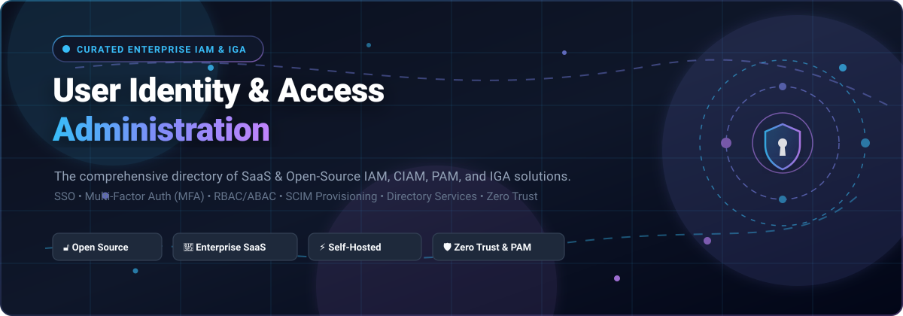

<p align="center">
  
</p>

# 🔐 Awesome User Identity & Access Administration (IAM & IGA) 🌟

<p align="center">
  <a href="https://github.com/ishandutta2007/Awesome-Awesome-Awesome"></a><a href="https://discord.gg/jc4xtF58Ve"></a>
  <a href="https://github.com/ishandutta2007/Awesome-User-Identity-Access-Administration/stargazers"></a>
  <a href="https://github.com/ishandutta2007/Awesome-User-Identity-Access-Administration/network/members"></a>
  <a href="https://github.com/ishandutta2007/Awesome-User-Identity-Access-Administration/blob/main/LICENSE"></a>
  <a href="https://github.com/ishandutta2007"></a>
</p>

> 🛡️ **A curated directory of top User Identity & Access Management (IAM), Identity Governance & Administration (IGA), Single Sign-On (SSO), Multi-Factor Authentication (MFA), Privileged Access Management (PAM), and Customer Identity (CIAM) platforms.**  
> Featuring deep feature analyses, transparent starting tier pricing, free tier limits, company valuation metrics, and top-tier open-source solutions.  
> 🌟 **Star this repository if you find it helpful!** 🌟

---

## 📑 Table of Contents

- [🌐 Sector Overview & Market Dynamics](#-sector-overview--market-dynamics)
- [🏢 SaaS & Hosted Commercial Platforms](#-saas--hosted-commercial-platforms)
- [🔓 Open-Source Software & Self-Hosted Solutions](#-open-source-software--self-hosted-solutions)
  - [1. Keycloak](#1-keycloak-)
  - [2. Authelia](#2-authelia-)
  - [3. Authentik](#3-authentik-)
  - [4. Teleport](#4-teleport-)
  - [5. Ory Hydra](#5-ory-hydra-)
  - [6. ZITADEL](#6-zitadel-)
  - [7. SuperTokens](#7-supertokens-)
  - [8. Logto](#8-logto-)
  - [9. Casdoor](#9-casdoor-)
  - [10. Ory Kratos](#10-ory-kratos-)
  - [11. Open Policy Agent (OPA)](#11-open-policy-agent-opa-)
  - [12. Dex IDP](#12-dex-idp-)
  - [13. Kanidm](#13-kanidm-)
  - [14. OPAL (Open Policy Administration Layer)](#14-opal-open-policy-administration-layer-)
  - [15. Cerbos](#15-cerbos-)
  - [16. HashiCorp Boundary](#16-hashicorp-boundary-)
  - [17. FreeIPA](#17-freeipa-)
  - [18. WSO2 Identity Server](#18-wso2-identity-server-)
  - [19. Evolveum midPoint](#19-evolveum-midpoint-)
  - [20. Apache Syncope](#20-apache-syncope-)
  - [21. Nubus](#21-nubus-)
  - [22. Hanzo IAM](#22-hanzo-iam-)
- [📊 Feature & Deployment Matrix at a Glance](#-feature--deployment-matrix-at-a-glance)
- [🤝 Contributing Guidelines](#-contributing-guidelines)
- [💖 Support & Sponsorship](#-support--sponsorship)
- [📈 Star History](#-star-history)
- [📜 License](#-license)

---

## 🌐 Sector Overview & Market Dynamics

The global Identity and Access Management (IAM) and Identity Governance and Administration (IGA) market was valued at **$18.1 billion in 2024 and is projected to reach over $45.2 billion by 2032**, expanding at a robust compound annual growth rate (CAGR) of approximately **12.2% to 14.5%**. Fueling this surge is the rapid adoption of Zero Trust architectures, API-first microservices, AI-assisted security governance, and mandatory regulatory compliance frameworks such as NIS2, GDPR, SOC 2, HIPAA, and ISO 27001.

The market exhibits **moderate fragmentation with strong hyperscaler concentration**. Mega-cloud ecosystems (Microsoft Entra ID, Google Cloud Identity, and AWS IAM) command massive baseline market share through default suite bundling in enterprise agreements. Concurrently, specialized standalone security leaders like Okta, CyberArk, and SailPoint retain high moats in vendor-neutral cross-cloud federation, privileged session vaults, and complex lifecycle governance. Alongside these commercial giants, the open-source ecosystem has accelerated dramatically—with modern protocols (OIDC, OAuth 2.1, SCIM, FIDO2/WebAuthn, Passkeys) enabling self-hosted alternatives like Keycloak, Authentik, and ZITADEL to capture major developer mindshare.

---

## 🏢 SaaS & Hosted Commercial Platforms

A comprehensive benchmark of leading commercial cloud-hosted User Identity and Access Administration platforms. Sorted by company scale (market capitalization or enterprise valuation) in descending order.

| Platform / Vendor | Focus & Architecture | Company Scale (Valuation / Market Cap) | Starting Tier Pricing | Free Tier / Free Trial Limits | Key Capabilities & Highlights |
|:-------------------|:----------------------|:---------------------------------------|:----------------------|:------------------------------|:------------------------------|
| **[Microsoft Entra ID](https://www.microsoft.com/en-us/security/business/identity-access/microsoft-entra-id)** | Enterprise cloud directory, workforce IAM & Conditional Access | **~$3.1 Trillion** *(Microsoft Corp NASDAQ: MSFT)* | **$3.00/user/month** *(Microsoft Entra ID P1; standalone plan)* | **Free forever tier:** Included with Microsoft 365 / Azure accounts with core directory, user sync, and basic SSO for up to 50,000 objects. Free trial is 30 days for 100 Entra ID P2 licenses. | Central enterprise directory, Conditional Access policies, seamless Microsoft 365 integration, passwordless auth, and multi-cloud identity protection. |
| **[Google Cloud Identity / Workspace Admin](https://cloud.google.com/identity)** | Cloud directory & identity for Google-first enterprises | **~$2.1 Trillion** *(Alphabet Inc NASDAQ: GOOGL)* | **$6.00/user/month** *(Google Cloud Identity Premium; or $6/mo Google Workspace Business Starter)* | **Free forever tier:** Cloud Identity Free edition supports up to 50 users with core directory, SSO, 2FA, and unified admin console. Free trial provides 30 days for up to 50 users on Premium. | Automated Google Workspace and Google Cloud IAM provisioning, context-aware device access rules, Titan Security Key enforcement, and Directory API controls. |
| **[CyberArk](https://www.cyberark.com)** | Privileged Access Management (PAM) & identity security | **~$13.2 Billion** *(NASDAQ: CYBR)* | **$10.00/user/month** *(CyberArk Workforce Identity starting base; PAM deployed on enterprise quotes starting ~$3,500/year)* | **30-day free trial:** Full-featured trial available for CyberArk Workforce Password Management and Secure Web Sessions for up to 50 users. No free forever plan. | Gold-standard administrative credential vaulting, session recording/isolation, least-privilege enforcement, and ephemeral access management. |
| **[Okta](https://www.okta.com)** | Vendor-neutral enterprise workforce & customer IAM | **~$12.5 Billion** *(NASDAQ: OKTA)* | **$2.00/user/month** *(Okta Single Sign-On starter; Okta Multi-Factor Auth starts at $3.00/user/month; $1,500 annual contract minimum)* | **30-day free trial:** Includes full access to Okta Workforce Identity Cloud (SSO, Adaptive MFA, Lifecycle Management) for up to 100 users. Auth0 developer tier offers a free forever plan up to 7,500 monthly active users. | Extensive pre-integrated app catalog (7,500+ SaaS apps), mature lifecycle SCIM provisioning, vendor-neutral identity orchestration, and universal directory. |
| **[SailPoint](https://www.sailpoint.com)** | Enterprise Identity Governance & Administration (IGA) | **~$6.9 Billion** *(Thoma Bravo acquisition / private equity)* | **$4.00/user/month** *(Starting base for Identity Security Cloud Standard suite on annual enterprise agreements)* | **30-day free trial:** Interactive sandbox environment and custom proof-of-concept (POC) access granted through guided enterprise trial. No perpetual free tier. | Automated access certifications, audit compliance campaigns, role mining, segregation of duties (SoD) enforcement, and automated joiner-mover-leaver lifecycle workflows. |
| **[Ping Identity](https://www.pingidentity.com)** | Enterprise hybrid federation & identity orchestration | **~$2.8 Billion** *(Thoma Bravo acquisition; merged with ForgeRock)* | **$3.00/user/month** *(PingOne for Workforce Essentials starting tier; billed annually)* | **30-day free trial:** Full access to PingOne Cloud Platform with SAML/OIDC SSO, MFA, and directory connector testing for up to 100 users. No free forever plan. | Complex legacy directory federation (PingFederate), multi-tenant enterprise orchestration, ForgeRock deep directory scale, and hybrid on-prem/cloud deployments. |
| **[Auth0](https://auth0.com)** | Developer-first customer & application authentication (CIAM) | **~$6.5 Billion** *(Acquired by Okta)* | **$23.00/month** *(B2C Essentials starting tier for up to 1,000 MAU; $130/month for B2B Essentials tier)* | **Free forever plan:** Supports up to 7,500 monthly active users (MAU), unlimited logins, up to 2 social identity providers, and customizable Universal Login. | Drop-in login box, rich SDKs across JavaScript, Python, Go, Swift, and Flutter, extensible Actions/Hooks architecture, and turnkey social/enterprise login. |
| **[JumpCloud](https://jumpcloud.com)** | Cloud open directory platform & unified endpoint management | **~$2.6 Billion** *(Series F valuation)* | **$9.00/user/month** *(JumpCloud Core Directory tier; $11/user/month for SSO + MFA package, billed annually)* | **Free forever plan:** Free for up to 10 users and 10 devices with full access to directory, SSO, MFA, MDM, and password manager, plus 10 days of premium support. | Replaces on-prem Active Directory, combines cross-OS device management (Windows, macOS, Linux, iOS, Android) with cloud LDAP, RADIUS, and SAML SSO. |
| **[OneLogin](https://www.onelogin.com)** | Workforce identity and access management | **~$1.2 Billion** *(Acquired by One Identity / Quest Software)* | **$2.00/user/month** *(Starter Single Sign-On; Enterprise package starts at $4.00/user/month with directory sync)* | **30-day free trial:** Full access to OneLogin Enterprise IAM including SmartFactor MFA, directory integration, and application catalog. No free forever tier. | Lightweight enterprise SSO, adaptive authentication, real-time Active Directory/LDAP connector sync, and streamlined user lifecycle management. |

---

## 🔓 Open-Source Software & Self-Hosted Solutions

Explore top-rated, self-hostable open-source identity and access administration platforms, sorted strictly by their GitHub stargazer counts in descending order.

### 1. [Keycloak](https://github.com/keycloak/keycloak) [](https://github.com/keycloak/keycloak/stargazers)
* **GitHub Repository:** [`keycloak/keycloak`](https://github.com/keycloak/keycloak)  
* **Tech Stack:** Java (Quarkus) | **License:** Apache-2.0  
* **Overview:** The undisputed gold standard of open-source Identity and Access Management maintained under Red Hat and the Cloud Native Computing Foundation ecosystem. Provides out-of-the-box OpenID Connect (OIDC), OAuth 2.0, SAML 2.0, Kerberos, and LDAP/AD user federation.  
* **Key Features:** Fine-grained authorization policies (RBAC/ABAC), centralized web management console, identity brokering, social logins, two-factor authentication, and turnkey clustering.  
* **Best For:** Enterprise organizations requiring a battle-tested, fully compliant identity server with deep community support and extensive enterprise integrations.

### 2. [Authelia](https://github.com/authelia/authelia) [](https://github.com/authelia/authelia/stargazers)
* **GitHub Repository:** [`authelia/authelia`](https://github.com/authelia/authelia)  
* **Tech Stack:** Go | **License:** Apache-2.0  
* **Overview:** A lightweight, high-performance authentication and authorization companion server designed to guard reverse proxies like Traefik, NGINX, Caddy, HAProxy, and Envoy with modern multi-factor authentication.  
* **Key Features:** OpenID Connect Certified™ Provider, FIDO2 WebAuthn / Passkeys support, TOTP authenticator app support, Duo push notifications, brute-force protection, and post-quantum cryptography readiness.  
* **Best For:** DevOps teams and homelab administrators seeking a streamlined, low-footprint single sign-on portal to protect private web applications and microservices behind reverse proxies.

### 3. [Authentik](https://github.com/goauthentik/authentik) [](https://github.com/goauthentik/authentik/stargazers)
* **GitHub Repository:** [`goauthentik/authentik`](https://github.com/goauthentik/authentik)  
* **Tech Stack:** Python (Django) / Go | **License:** MIT / Enterprise Dual  
* **Overview:** A modern, versatile open-source identity provider emphasizing extreme workflow flexibility through customizable stage-and-policy pipelines.  
* **Key Features:** Visual flow editor for signup, enrollment, and recovery; out-of-the-box SAML, OIDC, OAuth2, and LDAP outpost proxies; forward auth proxy; user impersonation for support; and granular RBAC.  
* **Best For:** Modern infrastructure teams wanting total programmatic control over complex login, MFA, and onboarding user flows without writing boilerplate code.

### 4. [Teleport](https://github.com/gravitational/teleport) [](https://github.com/gravitational/teleport/stargazers)
* **GitHub Repository:** [`gravitational/teleport`](https://github.com/gravitational/teleport)  
* **Tech Stack:** Go | **License:** AGPL-3.0 / Commercial  
* **Overview:** An identity-native infrastructure access management platform that replaces static credentials, VPNs, and SSH keys with short-lived cryptographic certificates and role-based access control.  
* **Key Features:** Unified Zero Trust access gateway for SSH servers, Kubernetes clusters, databases, Windows desktops, and internal web apps; live session recording, structured audit events, and Just-in-Time (JIT) access requests.  
* **Best For:** Infrastructure, SRE, and security teams needing privileged access management (PAM) and session auditing for multi-cloud production infrastructure.

### 5. [Ory Hydra](https://github.com/ory/hydra) [](https://github.com/ory/hydra/stargazers)
* **GitHub Repository:** [`ory/hydra`](https://github.com/ory/hydra)  
* **Tech Stack:** Go | **License:** Apache-2.0  
* **Overview:** An internet-scale, headless OpenID Connect (OIDC) and OAuth 2.1 authorization server. Unlike all-in-one IAMs, Hydra does not force its own user database or UI onto your applications—it connects to your existing user accounts via secure JSON APIs.  
* **Key Features:** OpenID Foundation Certified™, sub-millisecond response latency, fully headless architecture allowing completely custom user experiences, hardware security module (HSM) support, and infinite horizontal scalability.  
* **Best For:** High-scale engineering teams building custom customer-facing applications who need standards-compliant OAuth 2.1 token issuance without adopting a monolithic UI.

### 6. [ZITADEL](https://github.com/zitadel/zitadel) [](https://github.com/zitadel/zitadel/stargazers)
* **GitHub Repository:** [`zitadel/zitadel`](https://github.com/zitadel/zitadel)  
* **Tech Stack:** Go | **License:** Apache-2.0  
* **Overview:** A cloud-native, multi-tenant identity and access management system built from the ground up for modern B2B and SaaS applications. Built on event sourcing for complete auditability.  
* **Key Features:** Turnkey self-service B2B organization portals, domain whitelisting, custom branding per tenant, passwordless WebAuthn/Passkeys, OIDC/OAuth 2.1, and fine-grained authorization actions.  
* **Best For:** B2B SaaS software builders looking for an open-source alternative to Auth0 or WorkOS with first-class multi-tenancy and organization delegation.

### 7. [SuperTokens](https://github.com/supertokens/supertokens-core) [](https://github.com/supertokens/supertokens-core/stargazers)
* **GitHub Repository:** [`supertokens/supertokens-core`](https://github.com/supertokens/supertokens-core)  
* **Tech Stack:** Java / Node.js / React | **License:** Apache-2.0  
* **Overview:** An open-source, modular customer identity and access management (CIAM) solution crafted specifically for developers as a developer-friendly alternative to Auth0 and Firebase Auth.  
* **Key Features:** Pre-built customizable UI components for React/Vue/Angular, session token rotation with anti-CSRF protection, social SSO, passwordless magic links/OTP, enterprise SAML/ADFS integration, and role-based permissions.  
* **Best For:** Product developers seeking rapid authentication integration with modern pre-built UI components and end-to-end SDKs.

### 8. [Logto](https://github.com/logto-io/logto) [](https://github.com/logto-io/logto/stargazers)
* **GitHub Repository:** [`logto-io/logto`](https://github.com/logto-io/logto)  
* **Tech Stack:** TypeScript / Node.js | **License:** MPL-2.0  
* **Overview:** A beautifully designed, developer-centric authentication and authorization infrastructure for SaaS, web, and mobile apps, built natively on OpenID Connect and OAuth 2.1.  
* **Key Features:** Sleek out-of-the-box sign-in experience, enterprise SSO (SAML/OIDC), multi-tenant organization support, Machine-to-Machine (M2M) API protection, Webhooks, and modern Admin Console.  
* **Best For:** Modern web applications, startup teams, and AI platforms looking for quick developer onboarding and polished UI defaults.

### 9. [Casdoor](https://github.com/casdoor/casdoor) [](https://github.com/casdoor/casdoor/stargazers)
* **GitHub Repository:** [`casdoor/casdoor`](https://github.com/casdoor/casdoor)  
* **Tech Stack:** Go / React | **License:** Apache-2.0  
* **Overview:** A feature-packed, single-binary IAM and SSO platform with an intuitive web admin console, created by the authors of Casbin.  
* **Key Features:** 70+ built-in OAuth/social identity providers, native Casbin-powered ACL/RBAC/ABAC authorization, SCIM 2.0 user sync, WebAuthn/passkeys, TOTP MFA, multi-tenancy, and low-resource deployment.  
* **Best For:** Teams desiring a single self-contained binary deployment that provides both an identity provider and a rich access governance UI without external complexity.

### 10. [Ory Kratos](https://github.com/ory/kratos) [](https://github.com/ory/kratos/stargazers)
* **GitHub Repository:** [`ory/kratos`](https://github.com/ory/kratos)  
* **Tech Stack:** Go | **License:** Apache-2.0  
* **Overview:** A cloud-native, headless user identity and profile management engine built for web-scale deployment. Handles self-service user registration, login, profile updates, account recovery, and MFA via clean REST/JSON APIs.  
* **Key Features:** Zero default frontend (bring your own UI in any framework), schema-driven identity models with JSON Schema, passwordless WebAuthn, TOTP, SMS/Email OTP, and native integration with Ory Keto and Hydra.  
* **Best For:** Microservice and API-first architectures where security engineers want strict headless separation between identity logic and frontend presentation.

### 11. [Open Policy Agent (OPA)](https://github.com/open-policy-agent/opa) [](https://github.com/open-policy-agent/opa/stargazers)
* **GitHub Repository:** [`open-policy-agent/opa`](https://github.com/open-policy-agent/opa)  
* **Tech Stack:** Go | **License:** Apache-2.0  
* **Overview:** A CNCF Graduated, general-purpose policy engine that unifies access policy enforcement across cloud-native environments, microservices, Kubernetes admission, and API gateways.  
* **Key Features:** Declarative Rego query language, high-throughput in-memory evaluation, policy decision logging, and integration libraries across Envoy, Istio, Docker, and Kubernetes.  
* **Best For:** Organizations seeking unified, declarative Policy-as-Code for authorization, resource quotas, and compliance enforcement across hybrid multi-cloud systems.

### 12. [Dex IDP](https://github.com/dexidp/dex) [](https://github.com/dexidp/dex/stargazers)
* **GitHub Repository:** [`dexidp/dex`](https://github.com/dexidp/dex)  
* **Tech Stack:** Go | **License:** Apache-2.0  
* **Overview:** A federated OpenID Connect identity provider that acts as a broker and portal between downstream applications and upstream identity systems.  
* **Key Features:** Pluggable connector architecture supporting LDAP, SAML 2.0, GitHub, Google, GitLab, Bitbucket, and OAuth2; standard OIDC token claims translation; and lightweight Kubernetes deployment.  
* **Best For:** Kubernetes clusters and internal enterprise tools requiring simple federation to legacy corporate directories (LDAP/Active Directory) via modern OIDC tokens.

### 13. [Kanidm](https://github.com/kanidm/kanidm) [](https://github.com/kanidm/kanidm/stargazers)
* **GitHub Repository:** [`kanidm/kanidm`](https://github.com/kanidm/kanidm)  
* **Tech Stack:** Rust | **License:** MPL-2.0  
* **Overview:** A fast, memory-safe identity management platform and directory service written in Rust. Designed as a modern, hardened replacement for 389-ds, OpenLDAP, and Active Directory.  
* **Key Features:** Native LDAP and OIDC/OAuth 2.1 protocol support, built-in RADIUS server, memory-safe execution, WebAuthn/Passkey enforcement, fine-grained access control, and Unix client tools (`nsswitch`/`pam`).  
* **Best For:** System administrators looking for an ultra-fast, security-hardened, memory-safe modern directory service that easily serves both legacy Linux PAM environments and modern web applications.

### 14. [OPAL (Open Policy Administration Layer)](https://github.com/permitio/opal) [](https://github.com/permitio/opal/stargazers)
* **GitHub Repository:** [`permitio/opal`](https://github.com/permitio/opal)  
* **Tech Stack:** Python | **License:** Apache-2.0  
* **Overview:** An administration layer that manages authorization policy and data in real-time, bringing GitOps and live event-driven data streaming to policy engines like OPA and Cedar.  
* **Key Features:** Real-time data pub/sub engine, automatic Git repository tracking for policy updates, edge client caching, and webhook trigger integrations.  
* **Best For:** Teams running Open Policy Agent (OPA) that need to keep authorization policies and tenant application state synchronized in real-time across distributed edge microservices.

### 15. [Cerbos](https://github.com/cerbos/cerbos) [ ](https://github.com/cerbos/cerbos/stargazers)
* **GitHub Repository:** [`cerbos/cerbos`](https://github.com/cerbos/cerbos)  
* **Tech Stack:** Go | **License:** Apache-2.0  
* **Overview:** A lightweight, decoupled authorization service that allows developers to define context-aware role and attribute-based permissions (RBAC/ABAC) in human-readable YAML policies.  
* **Key Features:** Contextual authorization logic via YAML policies, sub-millisecond evaluation, WebAssembly (Wasm) compilation for in-browser client checking, and SDKs for Python, Node, Go, Java, and .NET.  
* **Best For:** Application engineering teams wanting clean, maintainable authorization policies decoupled from core business logic without learning complex custom DSLs.

### 16. [HashiCorp Boundary](https://github.com/hashicorp/boundary) [](https://github.com/hashicorp/boundary/stargazers)
* **GitHub Repository:** [`hashicorp/boundary`](https://github.com/hashicorp/boundary)  
* **Tech Stack:** Go | **License:** BSL 1.1  
* **Overview:** An identity-based access management system providing secure, least-privilege remote access to dynamic hosts, databases, and private cloud services without managing credentials or exposing networks.  
* **Key Features:** Identity-driven session authorization, automatic credential brokering (via HashiCorp Vault), dynamic target discovery (AWS, Azure, GCP, Kubernetes), and seamless desktop/CLI access clients.  
* **Best For:** Cloud infrastructure teams desiring automated, passwordless remote access controls integrated into HashiCorp Vault and Terraform ecosystems.

### 17. [FreeIPA](https://github.com/freeipa/freeipa) [](https://github.com/freeipa/freeipa/stargazers)
* **GitHub Repository:** [`freeipa/freeipa`](https://github.com/freeipa/freeipa)  
* **Tech Stack:** Python / C | **License:** GPL-3.0  
* **Overview:** The central identity, policy, and audit solution for networked Linux and Unix systems. Combines 389 Directory Server (LDAP), MIT Kerberos, Dogtag Certificate System, NTP, and DNS into a unified management domain.  
* **Key Features:** Centralized Linux host authentication, Host-Based Access Control (HBAC), sudo rule management, Active Directory cross-forest trust, automated TLS certificate authority, and web UI.  
* **Best For:** System administrators operating on-premise Linux environments needing complete domain controller services, Kerberos authentication, and Active Directory federation.

### 18. [WSO2 Identity Server](https://github.com/wso2/product-is) [](https://github.com/wso2/product-is/stargazers)
* **GitHub Repository:** [`wso2/product-is`](https://github.com/wso2/product-is)  
* **Tech Stack:** Java | **License:** Apache-2.0  
* **Overview:** A Digital Public Good-recognized open-source enterprise IAM platform deployed worldwide in finance, government, healthcare, and telecommunications.  
* **Key Features:** Comprehensive support for OAuth 2.0, OIDC, SAML 2.0, SCIM 2.0, FIDO2/WebAuthn, adaptive risk-based authentication, user account governance, and multi-tenant identity federation.  
* **Best For:** Highly regulated industries requiring an established enterprise-grade, standards-compliant IAM platform with multi-protocol legacy and modern bridge capabilities.

### 19. [Evolveum midPoint](https://github.com/Evolveum/midpoint) [](https://github.com/Evolveum/midpoint/stargazers)
* **GitHub Repository:** [`Evolveum/midpoint`](https://github.com/Evolveum/midpoint)  
* **Tech Stack:** Java | **License:** Open Source (Subscription Model)  
* **Overview:** The leading open-source Identity Governance and Administration (IGA) and Identity Management (IDM) platform.  
* **Key Features:** Automated joiner-mover-leaver lifecycle provisioning, policy-based approval workflows, Segregation of Duties (SoD) checks, recurring access certification campaigns, and comprehensive connector catalog (ConnId).  
* **Best For:** Large enterprises, universities, and healthcare systems needing an open-source alternative to SailPoint or Saviynt without per-identity software licensing costs.

### 20. [Apache Syncope](https://github.com/apache/syncope) [](https://github.com/apache/syncope)
* **GitHub Repository:** [`apache/syncope`](https://github.com/apache/syncope)  
* **Tech Stack:** Java | **License:** Apache-2.0  
* **Overview:** An open-source digital identity management, access governance, and provisioning engine governed under the Apache Software Foundation.  
* **Key Features:** Automated user, group, and role provisioning; delegated administration; SCIM 2.0 interface; audit logging and compliance reporting; and connector framework for active directory, databases, and enterprise apps.  
* **Best For:** Enterprise Java environments requiring a community-governed, extensible open-source Identity Governance and Administration framework.

### 21. [Nubus](https://github.com/univention/nubus) [](https://github.com/univention/nubus/stargazers)
* **GitHub Repository:** [`univention/nubus`](https://github.com/univention/nubus)  
* **Tech Stack:** Python / Go | **License:** AGPL-3.0-or-later  
* **Overview:** Developed by Univention as the identity core for sovereign cloud workplaces (such as the German sovereign openDesk suite). Delivers centralized user identity, role, and permission governance.  
* **Key Features:** Web management portal, integrated Single Sign-On (SAML/OIDC), self-service password reset, Kubernetes deployment readiness, and enterprise compliance audit logs.  
* **Best For:** European public sector organizations, educational institutions, and enterprises prioritizing digital sovereignty and open standards.

### 22. [Hanzo IAM](https://github.com/hanzoai/iam) [](https://github.com/hanzoai/iam/stargazers)
* **GitHub Repository:** [`hanzoai/iam`](https://github.com/hanzoai/iam)  
* **Tech Stack:** Go | **License:** Apache-2.0  
* **Overview:** An AI-first IAM gateway and auth server engineered with Model Context Protocol (MCP) server support, WebAuthn, OAuth 2.1, and SCIM automated user provisioning.  
* **Key Features:** AI/LLM tool authentication, MCP gateway security, SCIM provisioning, 40+ social identity providers, multi-tenancy, and containerized Docker architecture.  
* **Best For:** AI applications and modern engineering teams needing identity governance tailored for autonomous agents and Model Context Protocol tooling.

---

## 📊 Feature & Deployment Matrix at a Glance

| Software / Solution | Type | Primary License | Tech Stack | Self-Hosted | Primary Verification / Auth Standards | Target Focus & Best For |
|:--------------------|:-----|:----------------|:-----------|:-----------:|:--------------------------------------|:------------------------|
| **Microsoft Entra ID** | SaaS | Proprietary | Azure Cloud | ❌ | OIDC, SAML, FIDO2, Kerberos | M365 & enterprise cloud environments |
| **Google Cloud Identity**| SaaS | Proprietary | Google Cloud| ❌ | OIDC, SAML 2.0, WebAuthn | Google-first workforce administration |
| **CyberArk** | SaaS / Hybrid | Proprietary | Multi-cloud | Hybrid | Ephemeral Creds, RDP/SSH Proxy | Privileged Account Management (PAM) |
| **Okta** | SaaS | Proprietary | AWS Cloud | ❌ | SAML 2.0, OIDC, SCIM, FIDO2 | Universal enterprise workforce & CIAM |
| **SailPoint** | SaaS | Proprietary | Multi-cloud | ❌ | SCIM, REST Connectors, IGA Rules | Identity governance & access certifications |
| **Ping Identity** | SaaS / Hybrid | Proprietary | Multi-cloud | Hybrid | WS-Fed, SAML, OIDC, SCIM | Complex enterprise hybrid federation |
| **Auth0** | SaaS | Proprietary | Multi-cloud | ❌ | OIDC, OAuth 2.0, SAML, Social | Fast developer application CIAM |
| **JumpCloud** | SaaS | Proprietary | Cloud | ❌ | LDAP, RADIUS, SAML, MDM | Unified cloud directory & device controls |
| **OneLogin** | SaaS | Proprietary | Cloud | ❌ | SAML 2.0, OIDC, SCIM | Lightweight enterprise workforce IAM |
| **Keycloak** | OSS | Apache-2.0 | Java | ✅ | OIDC, OAuth 2.0, SAML 2.0, LDAP | Proven enterprise open-source standard |
| **Authelia** | OSS | Apache-2.0 | Go | ✅ | OIDC, FIDO2 WebAuthn, Duo, TOTP | Reverse proxy authentication companion |
| **Authentik** | OSS | MIT / Dual | Python / Go | ✅ | OIDC, SAML, LDAP, Forward Proxy | Flexible custom flow pipelines & proxy auth |
| **Teleport** | OSS | AGPL-3.0 | Go | ✅ | SSH/TLS Certificates, OIDC, SAML | Zero Trust infrastructure & PAM |
| **Ory Hydra** | OSS | Apache-2.0 | Go | ✅ | OAuth 2.1, OIDC Certified | Headless API-driven token authorization |
| **ZITADEL** | OSS | Apache-2.0 | Go | ✅ | OIDC, OAuth 2.1, Passkeys | Cloud-native multi-tenant B2B SaaS auth |
| **SuperTokens** | OSS | Apache-2.0 | Java / Node | ✅ | Session Cookies, OAuth 2.0, SAML | Developer-friendly CIAM with UI widgets |
| **Logto** | OSS | MPL-2.0 | TypeScript | ✅ | OIDC, OAuth 2.1, Enterprise SSO | Polished modern web & mobile app auth |
| **Casdoor** | OSS | Apache-2.0 | Go / React | ✅ | OAuth 2.0, SAML, CAS, LDAP, SCIM | All-in-one Go binary with 70+ providers |
| **Ory Kratos** | OSS | Apache-2.0 | Go | ✅ | REST/JSON APIs, WebAuthn, TOTP | Headless user profile & lifecycle engine |
| **Open Policy Agent** | OSS | Apache-2.0 | Go | ✅ | Rego Policy-as-Code | Cloud-native access policy enforcement |
| **Dex IDP** | OSS | Apache-2.0 | Go | ✅ | OIDC Connector Broker, LDAP | Kubernetes & multi-cluster federation |
| **Kanidm** | OSS | MPL-2.0 | Rust | ✅ | Native LDAP, OIDC, RADIUS, PAM | Memory-safe, high-speed directory server |
| **OPAL** | OSS | Apache-2.0 | Python | ✅ | Real-time Pub/Sub, GitOps Data | Real-time policy state administration |
| **Cerbos** | OSS | Apache-2.0 | Go | ✅ | YAML Policies, REST/gRPC, Wasm | Decoupled context-aware authorization |
| **Boundary** | Source-Avail| BSL 1.1 | Go | ✅ | Dynamic TCP/SSH Proxy, Vault | Identity-based remote infrastructure access |
| **FreeIPA** | OSS | GPL-3.0 | Python / C | ✅ | LDAP, Kerberos, DNS, Dogtag CA | Central Linux & Unix domain administration |
| **WSO2 Identity Server**| OSS | Apache-2.0 | Java | ✅ | OIDC, SAML, SCIM 2.0, FIDO2 | Regulated enterprise & public sector IAM |
| **Evolveum midPoint**| OSS | Subscription | Java | ✅ | IGA Lifecycle, ConnId, SCIM | Enterprise identity governance & audits |
| **Apache Syncope** | OSS | Apache-2.0 | Java | ✅ | SCIM 2.0, SAML, OIDC, ConnId | Community-governed open-source IGA |
| **Nubus** | OSS | AGPL-3.0 | Python / Go | ✅ | SAML, OIDC, Self-Service Portal | European digital sovereignty workplaces |
| **Hanzo IAM** | OSS | Apache-2.0 | Go | ✅ | OAuth 2.1, SCIM, MCP Gateway | AI agents & Model Context Protocol auth |

---

## 🤝 Contributing Guidelines

Contributions, suggestions, and corrections are warmly welcomed! To contribute a new tool or suggest improvements:

1. 🍴 **Fork the repository**.
2. 🌿 **Create a feature branch**:
   ```bash
   git checkout -b feat/add-iam-platform
   ```
3. 📝 **Add your tool** adhering to the existing format:
   - Tool name and direct website / GitHub link
   - GitHub stars social badge linking directly to stargazers: `[](https://github.com/<owner>/<repo>/stargazers)`
   - Tech stack & license details
   - Clear starting tier pricing and specific free trial / free tier limits
4. 🚀 **Submit a Pull Request** with a concise description of your changes.

---

## 💖 Support & Sponsorship

Thank you so much for exploring and using **Awesome User Identity & Access Administration**! 🙌  
If this curation has been helpful to your team, research, or projects, please consider supporting the project:

- ⭐ **Star** this repository on GitHub to help boost visibility!
- 🍴 **Fork** and contribute tools, corrections, or benchmarks!
- 📢 **Share** this list with fellow developers, security architects, and devops teams!
- ☕ **Buy me a coffee / Sponsor**: If you'd like to support ongoing maintenance and new tools discovery, visit the [GitHub Sponsors Dashboard](https://github.com/sponsors/ishandutta2007). Your support is greatly appreciated!

---

##  Star History
[](https://www.star-history.com/#ishandutta2007/Awesome-User-Identity-Access-Administration&type=date&legend=top-left)

---

## 📜 License

This compilation is shared under the [Creative Commons Zero v1.0 Universal](LICENSE) (CC0 1.0) Public Domain Dedication.  
All brand names, logos, product names, and registered trademarks belong to their respective owners.

---

<p align="center">
  ⭐ <b>Star this repository if you find it helpful!</b> ⭐
</p>
